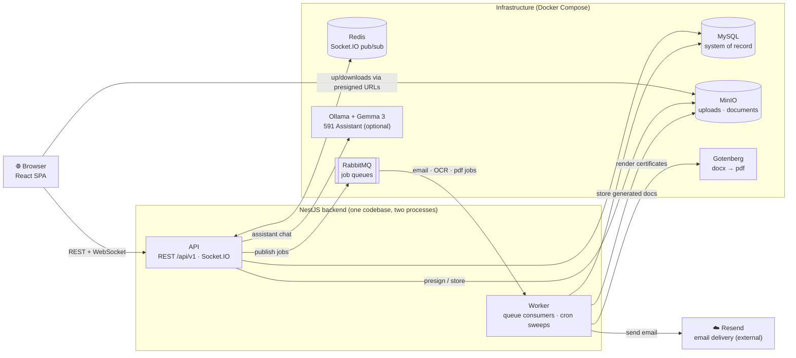

# Barangay 591 e-Services Portal

Capstone project — digitized barangay services (documents, complaints, bookings, health,
SOS, announcements) with ARTA SLA tracking. See `docs/` for requirements, architecture, and
the phased plan; the approved UI design is in `docs/design/`.
  
## High-level overview



The browser talks to the **API** over REST for data and a Socket.IO WebSocket for live
notifications and the 591 Assistant; file transfers go straight to **MinIO** using
short-lived presigned URLs so uploads never pass through the API. Anything slow —
sending email, OCR on uploaded IDs, rendering certificate PDFs through **Gotenberg** —
is published to **RabbitMQ** and handled by the **Worker**, which also runs scheduled
jobs like the ARTA overdue sweep. **Redis** relays Socket.IO events between processes,
and **MySQL** is the single source of truth.

## Tech stack

### Frontend — `apps/web`

- **React 19 + Vite** — single-page app; Vite provides the dev server with instant HMR
  and the production build.
- **TanStack Query** — all server state: fetches and caches API data, invalidates after
  mutations so lists refresh automatically.
- **Zustand** — lightweight client-side state (session, toasts, UI flags) without
  Redux-style boilerplate.
- **React Router** — routing with role-based portals (Resident / Employee / Admin see
  different navigation and pages).
- **Socket.IO client** — live notifications and the 591 Assistant chat over WebSockets.
- **Recharts** — charts on the analytics/report dashboards.
- **Leaflet** — the SOS incident map.
- **Axios** — HTTP client for the REST API.

### Backend — `apps/api`

- **NestJS** — modular Node.js framework with two entrypoints from one codebase: the HTTP
  API (`src/main.ts`) and the queue worker (`src/worker.ts`).
- **TypeORM + MySQL 8.4** — entities, repositories, and versioned SQL migrations
  (`npm run migration:run`).
- **Passport + JWT** — authentication with access/refresh tokens; passwords hashed with
  **bcryptjs**; DTOs validated by **class-validator**.
- **Socket.IO (+ Redis adapter)** — realtime gateway; Redis pub/sub fans events out so
  multiple API instances stay in sync.
- **RabbitMQ** (via `amqplib`) — async job queues (emails, OCR, document generation)
  consumed by the dedicated worker process.
- **MinIO** — S3-compatible object storage for uploads and generated documents, served to
  browsers through short-lived presigned URLs.
- **Tesseract.js** — OCR on uploaded IDs, cross-checked against the census masterlist for
  resident verification.
- **docxtemplater + PizZip + Gotenberg** — certificates are filled from `.docx` templates,
  then Gotenberg converts them to PDF; **PDFKit** generates simpler PDFs directly.
- **Nodemailer** — outbound email: MailHog dev inbox by default, **Resend** in production
  (see the Email section below).
- **@nestjs/schedule** — cron sweeps such as ARTA SLA / mediation-overdue flagging.
- **Ollama + Gemma 3** — optional local LLM behind the 591 Assistant; without it the
  assistant falls back to a rule-based bot.

### Shared & tooling

- **`packages/shared`** — TypeScript enums and DTO interfaces imported by both apps, so
  the API and UI can never disagree on types.
- **TypeScript everywhere** — one language across frontend, backend, and shared code, in
  an **npm workspaces** monorepo.
- **Docker Compose** — one command runs the full stack (or just the infrastructure);
  **Prettier** keeps formatting consistent.

## Quick start

Two ways to run it — pick one.

### Option A — everything in Docker

```bash
cp .env.example .env
docker compose up -d
```

That's it for the services: the `api` container installs dependencies, builds the shared
package, and runs migrations on boot, then `worker` and `web` start once it is healthy.
The **first** boot takes a few minutes (npm install + the Ollama model download) — follow
along with `docker compose logs -f api`.

Once the API is up, seed the database (run **one** of these):

```bash
# Demo data — census masterlist + the demo accounts listed below:
docker compose exec api npm run seed -w @brgy/api

# — or, for a CLEAN deployment (one admin + one employee, zero demo data):
docker compose exec -e ADMIN_EMAIL=kap@brgy591.gov.ph -e EMPLOYEE_EMAIL=sec@brgy591.gov.ph \
  api npm run seed:admin -w @brgy/api
```

Then open http://localhost:5173.

> **Troubleshooting (Docker Desktop / macOS):** on the very first boot, the container that
> creates the `node_modules` volume can miss the mount and `web`/`worker` crash with
> `sh: vite: not found`. Recreating `api` heals it:
>
> ```bash
> docker compose up -d --force-recreate api   # wait until healthy, then:
> docker compose up -d
> ```

### Option B — infrastructure in Docker, apps on host

```bash
cp .env.example .env
npm install

# Infrastructure (MySQL, Redis, RabbitMQ, MinIO, MailHog)
docker compose up -d mysql redis rabbitmq minio minio-init mailhog

npm run migration:run
npm run seed -w @brgy/api   # demo data: census masterlist + accounts below
# — or, for a CLEAN deployment (one admin + one employee, zero demo data):
# ADMIN_EMAIL=kap@brgy591.gov.ph EMPLOYEE_EMAIL=sec@brgy591.gov.ph npm run seed:admin -w @brgy/api

# In separate terminals:
npm run dev:api      # http://localhost:3000/api/v1
npm run dev:worker   # queue consumers
npm run dev:web      # http://localhost:5173
```

### Seeding notes

- `seed` (demo) wipes nothing but expects a fresh database — re-running it may duplicate
  demo rows; drop the `mysql_data` volume to start over.
- `seed:admin` (clean) also accepts `ADMIN_NAME/POSITION/PASSWORD` and
  `EMPLOYEE_NAME/POSITION/PASSWORD`; unset passwords are auto-generated and printed
  **once** in the command output. It is idempotent per role — safe to re-run.

## Demo accounts

All seeded accounts use the password **`password123`** — the portal opens based on the account's role.

| Portal | Email | Name / Notes |
|---|---|---|
| Resident | `antonette@gmail.com` | Antonette Potolin — starts as *Pending Verification* |
| Employee | `w.castro@brgy591.gov.ph` | William B. Castro |
| Admin | `chairman@brgy591.gov.ph` | Adrian O. Perlas (Chairman) |

New residents can also self-register via **Create an account** on the login page.

## Email — Resend instead of MailHog

Out of the box, all outbound email (invites, password resets, notifications) is caught by
**MailHog** at http://localhost:8025 — nothing leaves your machine. To send **real** email
through [Resend](https://resend.com), set one variable in `.env`:

```bash
# .env
RESEND_API_KEY=re_xxxxxxxxx   # create at https://resend.com/api-keys
MAIL_FROM="Barangay 591 <no-reply@yourdomain.com>"
```

- That single key switches **all** outbound mail to Resend (`smtp.resend.com:465`) — in
  both Docker and host-run dev; the `SMTP_*` (MailHog) vars are ignored while it is set.
- `MAIL_FROM` must use a domain [verified in Resend](https://resend.com/domains). Before
  verifying one, you can test with `MAIL_FROM="Barangay 591 <onboarding@resend.dev>"`
  (delivers only to your own Resend account email).
- Restart the api and worker after changing `.env`:
  `docker compose up -d --force-recreate api worker` (or restart your dev terminals).
- Leave `RESEND_API_KEY` empty to fall back to MailHog.

## Local service UIs

| Service | URL |
|---|---|
| Web app | http://localhost:5173 |
| API | http://localhost:3000/api/v1/health |
| RabbitMQ management | http://localhost:15673 (brgy / brgy_dev_password) |
| MinIO console | http://localhost:9003 (brgy-minio / brgy_dev_password) |
| MailHog (dev inbox — bypassed when Resend is configured) | http://localhost:8025 |

Host ports for Redis (6380), RabbitMQ (5673), and MinIO (9002/9003) are shifted off the
defaults to avoid clashing with other local projects; inside the compose network the
standard ports apply.

## Layout

```
apps/api        NestJS — HTTP API (src/main.ts) + queue worker (src/worker.ts)
apps/web        React + Vite SPA
packages/shared Shared TypeScript enums/types (build with: npm run build -w @brgy/shared)
docs/           requirements.md · architecture.md · plan.md · design/
```
